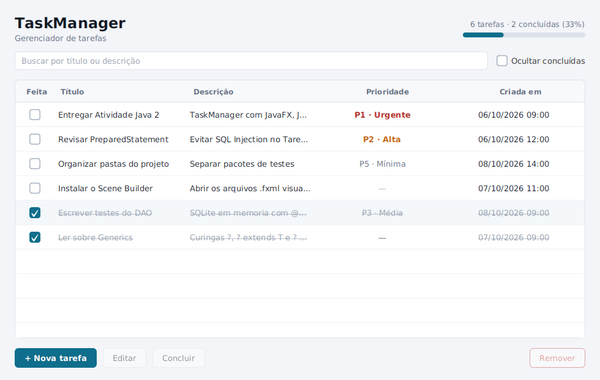
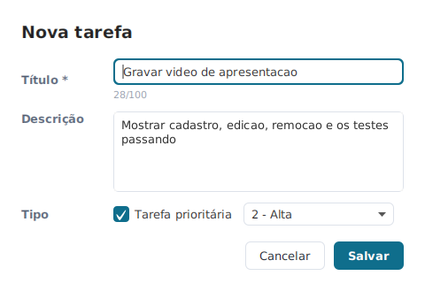
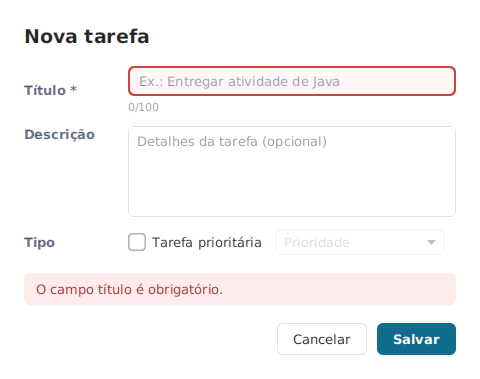
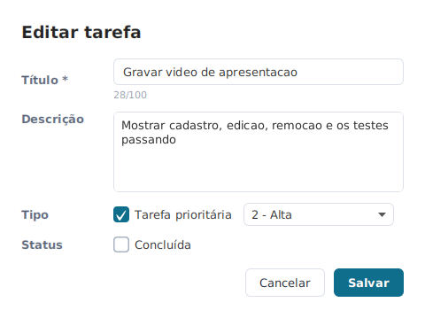
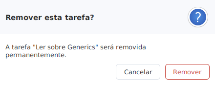

# Atividade Java 2 - Módulo Intermediário

**TaskManager FX** · Capacita iRede (Residência em TIC 20) · Unidade 5, Capítulo 1 · Prof. Alberson Dantas

Evolução do [TaskManager Console](https://github.com/Allanio007/Projeto-Capacita-Java/tree/main/Projeto1/taskmanager-console) (1ª entrega) para uma aplicação
desktop com **interface gráfica JavaFX**, **persistência em banco relacional (SQLite) via JDBC**,
estrutura de código com **Generics** e **testes automatizados com JUnit 5**.



## Funcionalidades

| Operação | Como fazer na tela |
|---|---|
| Criar tarefa (normal ou prioritária) | botão **+ Nova tarefa** |
| Listar tarefas | tabela da tela principal (carregada do banco) |
| Marcar / desmarcar como concluída | CheckBox da coluna **Feita** ou botão **Concluir / Reabrir** |
| Editar tarefa | botão **Editar** ou duplo clique na linha |
| Remover tarefa | botão **Remover** (pede confirmação) |
| Buscar | campo de busca (título ou descrição) |
| Filtrar | **Ocultar concluídas** |
| Acompanhar progresso | contador e barra de progresso no topo |

As tarefas ficam gravadas no arquivo `taskmanager.db`, criado automaticamente na pasta onde a
aplicação é executada. Fechar e abrir a aplicação mantém os dados.

## Como executar

Pré-requisitos: **JDK 17+** e **Maven 3.8+**. O Maven baixa o JavaFX (já com a versão do seu
sistema operacional), o driver SQLite e o JUnit, então não é preciso instalar nada além disso.

```bash
mvn clean test      # roda os 65 testes
mvn javafx:run      # abre a aplicação
```

**Pela IDE (IntelliJ, Eclipse, NetBeans, VS Code):** importe a pasta do repositório como projeto
Maven e execute a classe `br.com.taskmanager.app.Launcher`. Ela existe para rodar o JavaFX pela IDE
sem configurar `--module-path`.

**Scene Builder:** os arquivos `src/main/resources/br/com/taskmanager/fxml/*.fxml` podem ser abertos
e editados visualmente no Scene Builder.

## Arquitetura

```
src/main/java/br/com/taskmanager/
├── app/          MainApplication (extends Application, start(Stage)), Launcher
├── controller/   MainController, TarefaFormController   ← lógica das telas (@FXML)
├── service/      TarefaService                          ← regras de negócio (evolução do TaskManager)
├── dao/          Conexao, TarefaDAO                     ← JDBC isolado (padrão DAO)
├── generics/     ListaGenerica<T>, GenericDAO<T,ID>, UtilitariosGenericos
├── model/        ITarefa, BaseTarefa, Tarefa, TarefaPrioritaria
├── util/         ValidadorTarefa
└── exceptions/   EntradaInvalidaException, PersistenciaException

src/main/resources/br/com/taskmanager/
├── fxml/         main-view.fxml, tarefa-form.fxml       ← telas (separadas da lógica)
└── css/          style.css                              ← estilização

src/test/java/br/com/taskmanager/                        ← testes em pacotes separados
├── model/        TarefaTest
├── util/         ValidadorTarefaTest
├── generics/     ListaGenericaTest
├── dao/          TarefaDAOTest      (SQLite em memória)
└── service/      TarefaServiceTest  (SQLite em memória)
```

Fluxo de uma ação: **Tela (FXML) → Controller → TarefaService → TarefaDAO → SQLite**.

## Como cada requisito foi atendido

### 1. Generics
- `ListaGenerica<T>` (o exemplo do enunciado) com `adicionar`, `listarTodos` e `remover`, e também
  `filtrar`, `ordenar`, `buscarPrimeiro` e `copiarPara`.
  - O `TarefaService` guarda as tarefas numa `ListaGenerica<Tarefa>`.
- `GenericDAO<T, ID>` é o contrato de CRUD genérico. O `TarefaDAO` implementa `GenericDAO<Tarefa, Integer>`.
- Os três curingas aparecem em uso real:
  - `?` em `UtilitariosGenericos.contar(Collection<?>)`.
  - `? extends T` em `adicionarTodos(Collection<? extends T>)`, que aceita uma `List<TarefaPrioritaria>`
    numa `ListaGenerica<Tarefa>`, e em `contarConcluidas(Collection<? extends ITarefa>)`.
  - `? super T` em `copiarPara(Collection<? super T>)`, em `filtrar(Predicate<? super T>)` (o serviço filtra
    `Tarefa` com um `Predicate<ITarefa>`) e em `copiar(origem, destino)` (regra PECS).

### 2. JavaFX
- `MainApplication extends Application` e implementa `start(Stage)`. O menu de console foi substituído
  por telas.
- **Tela principal:** `TableView` com coluna de `CheckBox`, busca (`TextField`), filtro (`CheckBox`) e botões.
- **Tela de cadastro/edição:** janela modal com `TextField`, `TextArea`, `CheckBox` e `ComboBox` de
  prioridade. Valida os campos e mostra o erro na própria tela.
- **Confirmação ao remover:** `Alert` de confirmação, com **Cancelar** como botão padrão.
- **Layouts:** `BorderPane`, `VBox`, `HBox` e `GridPane`.
- **Eventos:** `onAction` no FXML e `setOnAction()` no CheckBox da tabela.

### 3. FXML e CSS
- As telas ficam em `.fxml`, ligadas ao controller por `fx:controller` e `@FXML`.
  - Exemplo: `<Button text="Salvar" onAction="#salvarTarefa"/>`.
- A aparência é toda definida em `style.css`.

### 4. JDBC
- Banco SQLite com a tabela `tarefas`, criada automaticamente (`CREATE TABLE IF NOT EXISTS`):

  ```sql
  CREATE TABLE tarefas (
      id           INTEGER PRIMARY KEY AUTOINCREMENT,
      titulo       VARCHAR(100) NOT NULL,
      descricao    TEXT,
      concluida    BOOLEAN NOT NULL DEFAULT 0,
      prioridade   INTEGER,   -- NULL = tarefa normal; 1..5 = TarefaPrioritaria
      data_criacao TEXT NOT NULL
  );
  ```

  Em relação ao enunciado, há duas colunas a mais: `prioridade` e `data_criacao`. Elas guardam o que
  o modelo da 1ª entrega já tinha, e o tipo da tarefa (normal ou prioritária) é reconstruído ao ler
  do banco.
- **`Conexao.java`:** conecta com `DriverManager` e centraliza o acesso ao banco.
- **`TarefaDAO`:** faz inserir, consultar, atualizar e excluir com `PreparedStatement` e `ResultSet`.
- **Transações:** toda escrita usa `commit()` / `rollback()`. O método `inserirTodos` grava um lote
  "tudo ou nada".
- **SQL Injection:** nenhum texto digitado é concatenado no SQL. Um teste comprova isso.
- **Erros SQL:** são registrados em log (`java.util.logging`) e convertidos em `PersistenciaException`.

### 5. JUnit 5 — 65 testes

Os testes usam `@Test`, `@BeforeEach`, `@AfterEach`, `@DisplayName` e `@ParameterizedTest`, com
`assertEquals`, `assertThrows` e `assertInstanceOf`.

| Classe de teste | Testes | Cobre |
|---|---|---|
| `TarefaTest` | 6 | criação de tarefa, conclusão/reabertura, prioridade inválida, igualdade |
| `ValidadorTarefaTest` | 19 | validação de dados: título vazio/nulo/longo, descrição, prioridade 1–5 |
| `ListaGenericaTest` | 9 | operações genéricas e os curingas `?`, `? extends`, `? super` |
| `TarefaDAOTest` | 17 | DAO com **SQLite em memória**: CRUD, tipos, ordenação, SQL Injection, rollback |
| `TarefaServiceTest` | 14 | regras de negócio, incluindo os 3 testes da 1ª entrega adaptados |

Cada teste de banco recebe um banco **novo e vazio em memória** (`jdbc:sqlite::memory:`), criado no
`@BeforeEach` e descartado no `@AfterEach`. Por isso os testes são independentes entre si.

## Telas

| Cadastro | Validação |
|---|---|
|  |  |

| Edição | Confirmação ao remover |
|---|---|
|  |  |

## O que mudou em relação à 1ª entrega

| Console (1ª entrega) | FX (esta entrega) |
|---|---|
| Menu `Scanner` + `switch` | Telas JavaFX com FXML e CSS |
| `ArrayList<Tarefa>` em memória | SQLite via JDBC; `ListaGenerica<Tarefa>` como cópia em memória |
| Id `UUID` gerado em memória | Id `INTEGER AUTOINCREMENT` gerado pelo banco |
| Operações por índice (1, 2, 3…) | Operações pelo id da tarefa selecionada |
| Criar, listar, concluir, remover | Mais **editar**, **reabrir**, buscar, filtrar e confirmação ao remover |
| 3 testes | 65 testes, incluindo DAO com SQLite em memória |

## Entrega

Checklist que relaciona cada requisito do enunciado ao arquivo correspondente: [`ENTREGA-MODULO-INTERMEDIARIO.md`](ENTREGA-MODULO-INTERMEDIARIO.md).
